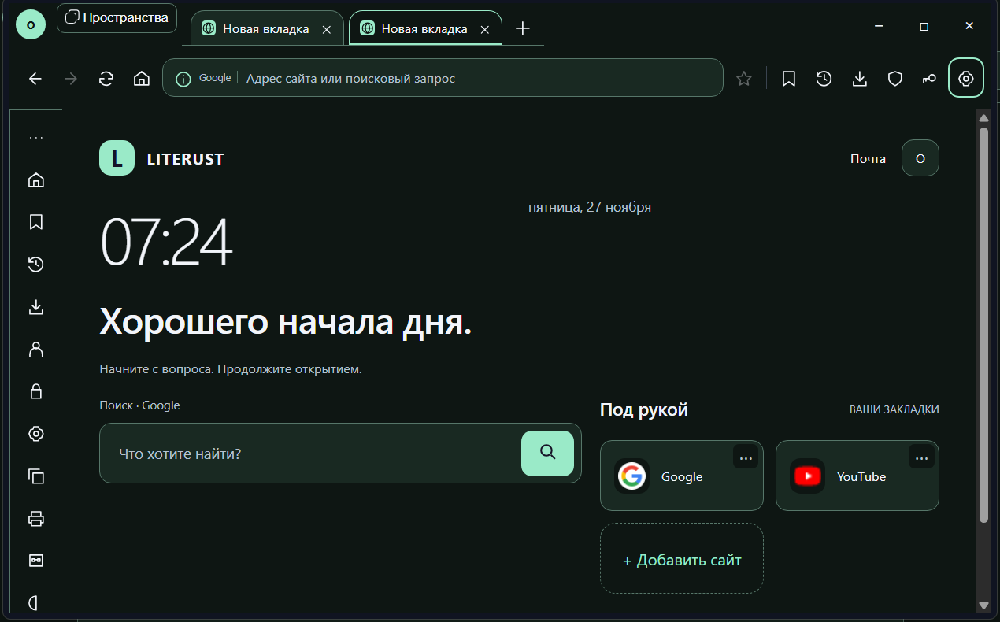

# LiteRust

[Русский](README.md)

LiteRust is a Windows browser built with Rust, Tao, Wry and Microsoft WebView2. Separate profiles keep work and personal browsing apart. Workspaces within a profile share site logins.

[View settings, VPN and print preview](docs/screenshots.md)

The browser supports ordinary and private windows, tab groups, Split View, bookmarks, downloads, local notes and an address bar with local suggestions. Settings, appearance, accounts, password preferences, downloads, bookmarks and history have internal addresses. Opening a service page again selects the existing tab.

Drag home widgets to rearrange them or use their corner handles to resize them. The appearance editor supports background and accent colors, individual control colors, named palettes and JSON import and export.

The toolbar VPN button controls a configured server. Browser proxy mode uses Xray and system tunnel mode uses sing-box. Password preferences can enable WebView2 save and update prompts. Previously saved credentials can remain available when saving is disabled. Google Password Manager and Yandex ID open as websites. Store extension installation and cross-browser password sync are unavailable in this version.

Ctrl+P opens WebView2 print preview. Available printer settings depend on the Windows driver. Under Tools → Print, select Save PDF to export with custom headers and footers, A4 or Letter paper, portrait or landscape orientation, 25–200% scale, and 0–40 mm margins.

## Install or build

LiteRust targets Windows 10 and 11 x64 with Microsoft Edge WebView2 Runtime. Download the installer and checksum from the same release. Use Windows Default Apps to associate HTTP and HTTPS with LiteRust. [Releases](https://github.com/m1rak03/LiteRust/releases) · [Installation](docs/INSTALLATION.md)

Install Rust and Visual Studio Build Tools with C++ tools and the Windows SDK. From the repository root run:

~~~powershell
cargo test --locked
cargo build --locked --release
~~~

Interface tests are in tools. LiteRust uses the [MIT license](LICENSE). Third-party notices are in vendor. [Security](SECURITY.md)
