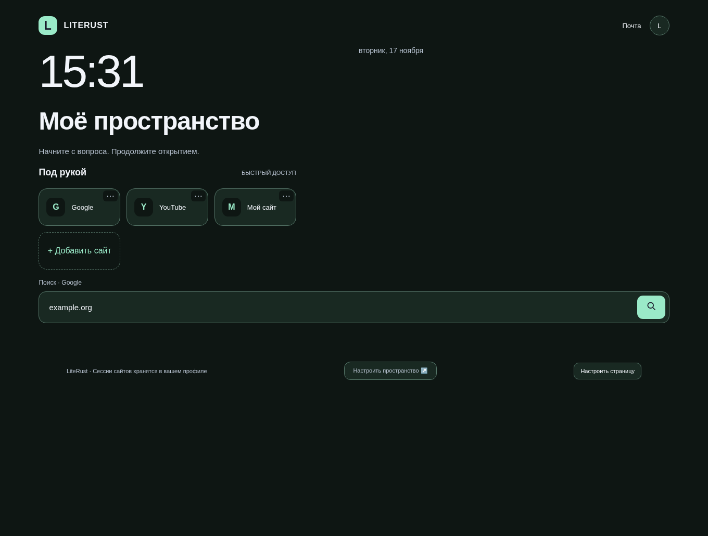
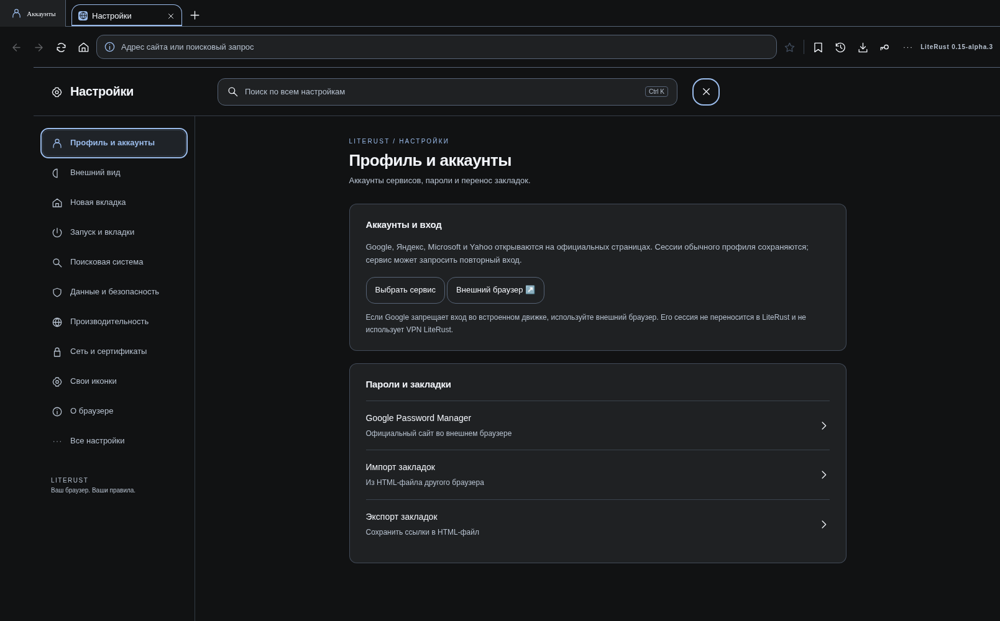
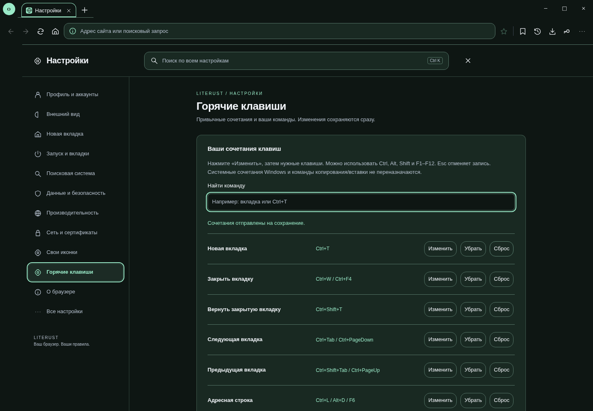
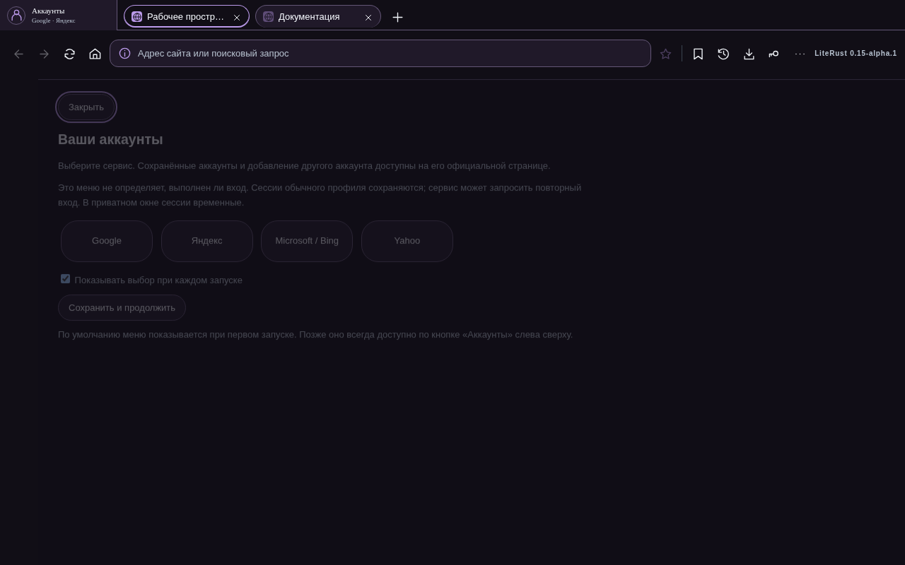
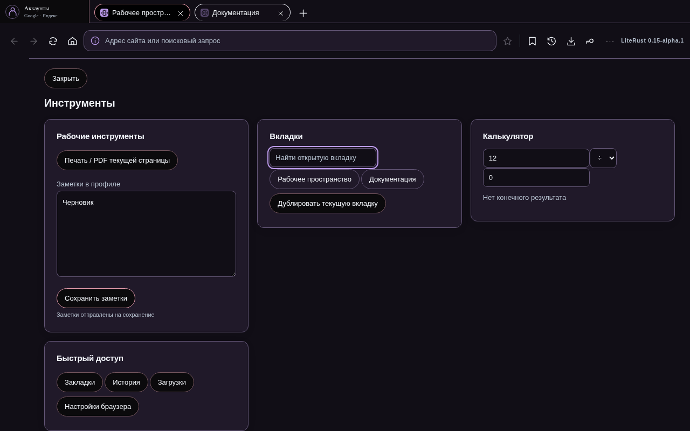

<p align="center"></p>
# LiteRust

[Русский](README.md) · [English](README.en.md)

LiteRust — браузер для Windows на Rust и Microsoft WebView2. На главной можно собрать свою страницу из быстрых ссылок и виджетов, а для работы и личных дел завести отдельные профили. Закладки, историю и загрузки можно открыть из боковой панели.
<p align="center">


<a href="LICENSE"></a>
</p>
<p align="center"><a href="https://github.com/m1rak03/LiteRust/releases">Релизы</a> · <a href="docs/SETTINGS.md">Настройки</a> · <a href="docs/INSTALLATION.md">Установка</a> · <a href="SECURITY.md">Безопасность</a> · <a href="CONTRIBUTING.md">Участие</a></p>

## Пространство под ваш стиль

**Пять направлений дизайна · 30 форм вкладок · 330 цветовых тем.**

Выбирайте спокойную «Орбиту», строгий «Минимализм», воздушную «Студию», «Классику» или «Терминал». Карточки показывают настоящий вид вкладок; направление меняет также панели и адресную строку.

Меняйте акцент, размер текста, скругления и иконки. Выбирайте цвет, градиент или свои обои. Отключайте анимации, скрывайте лишние элементы и настраивайте новую вкладку под свои задачи.


## Главная, которую можно собрать самому

Меняйте местами часы, поиск и быстрые сайты, задавайте ширину карточек и скрывайте ненужное. У редактора есть отмена, сброс и явное сохранение. Быстрые сайты отделены от закладок; локальные профили — от аккаунтов Google и Яндекса.



[Отчёт о модернизации: архитектура, проверки и ограничения](docs/modernization/REPORT.md).

## Настройки без лишних переходов

Разделы слева, поиск по всем параметрам сверху и карточки справа. Черновики настроек запуска сохраняются при переключении разделов.



## Окна

Ctrl+N открывает обычное окно, «Следующее окно» переключает окна профиля, а Ctrl+W закрывает вкладку или её окно, если вкладка последняя. В режиме восстановления LiteRust открывает последние сохранённые окна. [Подробности](docs/releases/0.16.0-alpha.4.md).

## Две страницы в одном окне

Откройте две вкладки, щёлкните правой кнопкой по одной из них и выберите «Открыть рядом». У каждой области своя адресная строка и прокрутка. На панели можно выбрать вкладки, расположить их рядом или друг над другом, изменить размеры и поменять области местами. [Подробности о Split View](docs/releases/0.17.0-alpha.2.md).

Рабочие пространства помогают держать отдельные наборы вкладок, групп и быстрых сайтов в одном профиле. Откройте кнопку «Пространства» рядом с профилем. Для одновременной работы откройте второе окно и выберите другое пространство. [Рабочие пространства](docs/releases/0.17.0-alpha.3.md)

## Группы вкладок

Щёлкните правой кнопкой по вкладке и выберите «Создать группу». Ctrl+щелчок выделяет несколько вкладок для общей группы. Щелчок по заголовку сворачивает группу, а его контекстное меню позволяет менять имя и цвет, закреплять группу и разгруппировывать вкладки. [Примечания к 0.17.0-alpha.1](docs/releases/0.17.0-alpha.1.md).

## Загрузки и закладки

Откройте «Загрузки», чтобы отфильтровать список, проверить прогресс или перейти в папку файла. Пауза, возобновление и отмена доступны в зависимости от состояния загрузки в WebView2. Очистка истории завершённых загрузок оставляет файлы на диске.

В менеджере закладок можно искать сайты, сортировать список по дате, названию или адресу, создавать папки и переносить в них закладки. При удалении папки её закладки возвращаются в общий список. [Примечания к 0.16.0-alpha.5](docs/releases/0.16.0-alpha.5.md).

## Горячие клавиши

34 команды с привычными сочетаниями: вкладки, адресная строка, история, загрузки, поиск, печать и масштаб. В **Настройки → Горячие клавиши** можно назначить своё сочетание, убрать его или восстановить стандартное. Конфликты проверяются до сохранения.

Окно запускается развёрнутым, с вкладками и кнопками управления в одной панели. Панель задач Windows остаётся доступной; отдельный режим F11 удалён. Обычное второе окно Ctrl+N пока не поддерживается; приватное окно открывается через Ctrl+Shift+N.

<details><summary>Редактор сочетаний</summary>



</details>

## Что внутри

| Возможность | Что можно делать |
| --- | --- |
| Новая вкладка | Редактор сетки: порядок, ширина и видимость виджетов; до 24 отдельных быстрых сайтов |
| Боковая панель | Раскрытие по нажатию или наведению, закрепление, порядок и скрытие действий |
| Поиск | Google, Яндекс, DuckDuckGo, Bing и Brave |
| Аккаунты | Официальные страницы Google, Яндекса, Microsoft и Yahoo; меню при первом или каждом запуске |
| Инструменты | Найти и дублировать вкладку, сохранить заметку, посчитать, открыть печать/PDF |
| Поведение | Домашняя страница, восстановление вкладок, фоновое открытие ссылок, масштаб 50–200% |
| Память | Ограничение живых вкладок и управляемая выгрузка фоновых страниц |
| VPN | Xray для браузера; системный режим через sing-box с подтверждением администратора |
| Профили | До 16 локальных профилей со своими данными и аватарами; приватное окно, защита метаданных Windows DPAPI |

<details><summary>Посмотреть аккаунты и инструменты</summary>




</details>

Скриншоты сделаны в Chromium при локальной проверке интерфейса. Они не являются подтверждением работы Windows-сборки.

## Скачать и установить

Откройте [страницу релизов](https://github.com/m1rak03/LiteRust/releases) и проверьте описание конкретного выпуска. Для обычной установки выбирайте опубликованный **Setup-x64.exe**, если он есть в Assets, а не архив исходников.

Актуальный установщик Windows x64 и контрольные суммы доступны на [странице выпусков](https://github.com/m1rak03/LiteRust/releases).

LiteRust требует WebView2 Runtime. Полный установщик включает его установку, файлы браузера и необходимые компоненты; один EXE из `target/release` не является готовым дистрибутивом. [Подробности установки и чёрного окна](docs/INSTALLATION.md).

## Поиск, печать и язык

- Адресная строка и поиск на новой вкладке предлагают сайты из закладок и истории текущего профиля. В приватном окне эти подсказки выключены.
- Поисковым системам передаётся предпочтение светлой или тёмной темы. Поисковик может использовать собственную настройку. DuckDuckGo получает также параметр темы в поисковом адресе.
- В разделе «Инструменты → Печать» можно открыть предпросмотр или сохранить PDF. При экспорте задаются заголовок, текст внизу страницы и печать фона. Для печати с этим текстом отправьте сохранённый PDF на принтер.
- Язык меняется в «Настройки → Запуск и вкладки». После сохранения перезапустите LiteRust.

[Управление профилями, архивом и резервными копиями](docs/PROFILES.md).

## Аккаунты, сертификаты и ограничения

- «Аккаунты» открывают официальные страницы Google, Яндекса, Microsoft, Yahoo, Opera и Mozilla (Firefox). Каждый сервис управляет входом и может запросить повторную авторизацию. У каждого локального профиля LiteRust свои сессии.
- Chrome Sync и автозаполнение Google Password Manager не реализованы. Сессия внешнего браузера не переносится в LiteRust.
- Для сайтов с сертификатами НУЦ откройте «Настройки → Сеть и сертификаты». Там есть [инструкция Госуслуг](https://www.gosuslugi.ru/tls), [сайт НУЦ](https://nuc.voskhod.ru/) и кнопка открытия хранилища сертификатов текущего пользователя Windows. Установку корневого и промежуточного сертификатов выполняет пользователь по официальной инструкции. WebView2 продолжает проверять TLS.
- Tor с мостами пока не включён. Системный VPN требует компонентов и прав администратора, действует пока запущен LiteRust и не гарантирует незаметность.
- Выгрузка вкладок может потерять несохранённые формы. Измеренного сравнительного выигрыша по ОЗУ пока нет.
- DPAPI защищает метаданные и резервные копии профиля, но не весь кэш WebView2 и не скачанные файлы. Программа под вашей учётной записью может получить доступ к данным. [Модель защиты](SECURITY.md).

## Разработка

```sh
cargo fmt --all -- --check
cargo test --locked --no-default-features --lib
node tools/check-source.mjs
node tools/test-security.cjs
node tools/test-settings.cjs
node tools/test-accounts-tools.cjs
node tools/test-ui.cjs
```

UI-тестам нужны Node.js, Playwright и Chromium. Для сборки Windows нужны Rust MSVC, Visual Studio Build Tools и Windows SDK:

```powershell
cargo build --locked --release
```

Состав дистрибутива описан в [инструкции установки](docs/INSTALLATION.md). [Результаты локальных проверок](docs/LOCAL-VALIDATION.md) отделены от испытаний Windows-приложения.

Архив исходников без кэша и журналов:

```sh
python tools/package-source.py --output-dir ../output
```

## Обратная связь

Нашли ошибку — [создайте обращение](https://github.com/m1rak03/LiteRust/issues/new/choose) с версией, шагами воспроизведения и ожидаемым результатом. Уязвимости описывайте по правилам [SECURITY.md](SECURITY.md); не публикуйте пароли, cookies, VPN-ключи и файлы профиля.

Код LiteRust распространяется по [MIT](LICENSE). Лицензии сторонних компонентов находятся в `vendor/` и поставляются отдельно.
