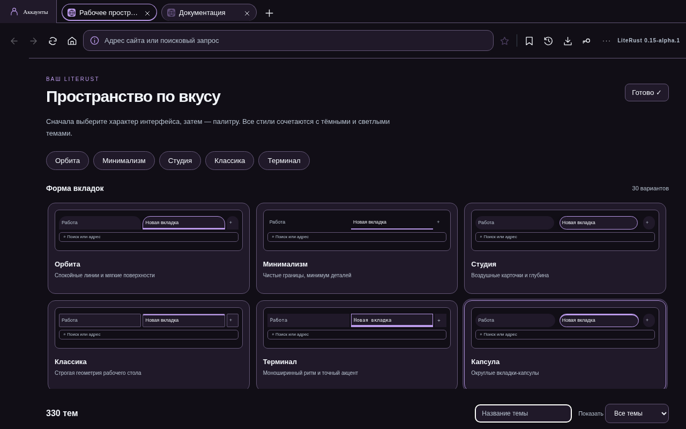

<p align="center"></p>
<p align="center"><strong>Браузер для Windows на Rust и Microsoft WebView2</strong><br>Настраиваемое рабочее пространство, постоянный профиль и VPN-хаб.</p>
<p align="center">


<a href="LICENSE"></a>
</p>
<p align="center"><a href="https://github.com/m1rak03/LiteRust/releases">Релизы</a> · <a href="docs/SETTINGS.md">Настройки</a> · <a href="docs/INSTALLATION.md">Установка</a> · <a href="SECURITY.md">Безопасность</a> · <a href="CONTRIBUTING.md">Участие</a></p>

## Пространство под ваш стиль

**Пять направлений дизайна · 30 форм вкладок · 330 цветовых тем.**

Выбирайте спокойную «Орбиту», строгий «Минимализм», воздушную «Студию», «Классику» или «Терминал». Карточки показывают настоящий вид вкладок; направление меняет также панели и адресную строку.

Меняйте акцент, размер текста, скругления и иконки. Выбирайте цвет, градиент или свои обои. Отключайте анимации, скрывайте лишние элементы и настраивайте новую вкладку под свои задачи.



## Что внутри

| Возможность | Что можно делать |
| --- | --- |
| Новая вкладка | Три компоновки, до 20 ссылок, часы 12/24, фото, цвет и два вида градиента |
| Поиск | Google, Яндекс, DuckDuckGo, Bing и Brave |
| Аккаунты | Официальные страницы Google, Яндекса, Microsoft и Yahoo; меню при первом или каждом запуске |
| Инструменты | Найти и дублировать вкладку, сохранить заметку, посчитать, открыть печать/PDF |
| Поведение | Домашняя страница, восстановление вкладок, фоновое открытие ссылок, масштаб 50–200% |
| Память | Ограничение живых вкладок и управляемая выгрузка фоновых страниц |
| VPN | Xray для браузера; системный режим через sing-box с подтверждением администратора |
| Профиль | Постоянные сессии сайтов, приватное окно, защита метаданных Windows DPAPI |

<details><summary>Посмотреть аккаунты и инструменты</summary>


</details>

Скриншоты сделаны в Chromium при локальной проверке интерфейса. Они не являются подтверждением работы Windows-сборки.

## Скачать и установить

Откройте [страницу релизов](https://github.com/m1rak03/LiteRust/releases) и проверьте описание конкретного выпуска. Для обычной установки выбирайте опубликованный **Setup-x64.exe**, если он есть в Assets, а не архив исходников.

**Текущая версия исходников: `0.15.0-alpha.2`. Установщик этой версии ещё не собран и не проверен на Windows.** Ссылка на релизы не означает, что этот выпуск уже опубликован.

LiteRust требует WebView2 Runtime. Полный установщик должен включать его установку, файлы браузера и необходимые компоненты; один EXE из `target/release` не является готовым дистрибутивом. [Подробности установки и чёрного окна](docs/INSTALLATION.md).

## Аккаунты, сертификаты и ограничения

- «Аккаунты» — меню сервисов, а не индикатор авторизации. Выбор сохранённых аккаунтов выполняет официальный сайт. Cookies обычного профиля сохраняются, но сервис вправе потребовать повторный вход или ограничить WebView2.
- Chrome Sync и автозаполнение Google Password Manager не реализованы. Сессия внешнего браузера не переносится в LiteRust.
- Смена поисковика не меняет движок и доверие TLS. Для сайтов с отечественными сертификатами предусмотрены ссылка на официальные инструкции и прямой переход; проверка сертификатов не отключается. Доступ к конкретному сайту аттестации на Windows ещё не подтверждён.
- Tor с мостами пока не включён. Системный VPN требует компонентов и прав администратора, действует пока запущен LiteRust и не гарантирует незаметность.
- Выгрузка вкладок может потерять несохранённые формы. Измеренного сравнительного выигрыша по ОЗУ пока нет.
- DPAPI защищает метаданные и резервные копии профиля, но не весь кэш WebView2 и не скачанные файлы. Программа под вашей учётной записью может получить доступ к данным. [Модель защиты](SECURITY.md).

## Разработка

```sh
cargo fmt --all -- --check
cargo test --locked --no-default-features --lib
node tools/check-source.mjs
node tools/test-security.cjs
node tools/test-settings.cjs
node tools/test-accounts-tools.cjs
node tools/test-ui.cjs
```

UI-тестам нужны Node.js, Playwright и Chromium. Для сборки Windows нужны Rust MSVC, Visual Studio Build Tools и Windows SDK:

```powershell
cargo build --locked --release
```

Состав дистрибутива описан в [инструкции установки](docs/INSTALLATION.md). [Результаты локальных проверок](docs/LOCAL-VALIDATION.md) отделены от испытаний Windows-приложения.

Архив исходников без кэша и журналов:

```sh
python tools/package-source.py --output-dir ../output
```

## Обратная связь

Нашли ошибку — [создайте обращение](https://github.com/m1rak03/LiteRust/issues/new/choose) с версией, шагами воспроизведения и ожидаемым результатом. Уязвимости описывайте по правилам [SECURITY.md](SECURITY.md); не публикуйте пароли, cookies, VPN-ключи и файлы профиля.

Код LiteRust распространяется по [MIT](LICENSE). Лицензии сторонних компонентов находятся в `vendor/` и поставляются отдельно.
