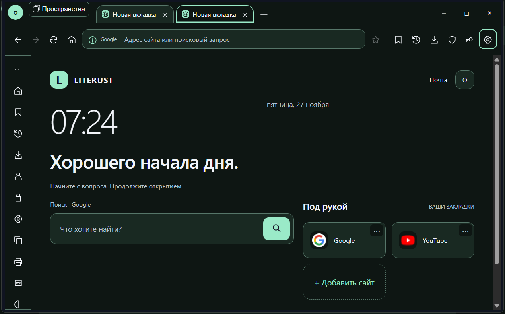

# LiteRust

[English](README.en.md)

LiteRust — небольшой браузер для Windows. Интерфейс написан на Rust, HTML и JavaScript, а сайты открывает Microsoft WebView2. Я собираю его вокруг локальных профилей: в одном можно держать рабочие вкладки и закладки, в другом — личные. Рабочие пространства внутри одного профиля используют общую авторизацию на сайтах.

[Посмотреть настройки, VPN и печать](docs/screenshots.md)

## Вкладки и инструменты

Обычные и приватные окна поддерживают группы вкладок и Split View. История, настройки, закладки, загрузки, оформление, аккаунты и параметры паролей открываются по внутренним адресам. Повторное открытие возвращает к существующей вкладке. В менеджере загрузок можно открыть папку и управлять загрузкой, пока это разрешает движок.

На главной странице можно переставлять блоки, менять их ширину и редактировать быстрые ссылки. В адресной строке доступны открытые вкладки, закладки, история и команды. В инструментах есть заметки с привязкой к странице, поиск, калькулятор и сохранение HTML.

## Оформление

У готовых тем можно менять фон, акцент и цвета отдельных элементов. Разверните расширенный редактор, чтобы изменить вкладки, поля ввода или выделение. Палитры хранятся в профиле. Их можно сохранить под именем или перенести в другую установку через JSON.

## VPN, пароли и печать

- Кнопка VPN находится в верхней панели. Браузерный прокси использует Xray, режим системного туннеля — sing-box. Для подключения нужен действующий сервер.
- В разделе паролей можно включить предложения WebView2 сохранить или обновить пароль. Старые записи могут появляться в подсказках после отключения сохранения. Google Password Manager и Яндекс ID открываются как официальные сайты. Синхронизация с хранилищами других браузеров и установка расширений из магазинов в этой версии недоступны.
- Ctrl+P открывает предпросмотр WebView2 для активной страницы. Выбор принтера, доступные параметры и сохранение в PDF зависят от среды Windows. В разделе «Инструменты → Печать» можно сохранить PDF с собственными колонтитулами, выбрать A4 или Letter, ориентацию, масштаб (25–200 %) и поля (0–40 мм). Эти параметры применяются при нажатии «Сохранить PDF».

## Установка и сборка

Проект рассчитан на Windows 10 и 11 x64 с Microsoft Edge WebView2 Runtime. Скачайте установщик и контрольную сумму из одного выпуска. Чтобы открывать HTTP- и HTTPS-ссылки в LiteRust, выберите его в параметрах приложений по умолчанию Windows. [Выпуски](https://github.com/m1rak03/LiteRust/releases) · [Инструкция по установке](docs/INSTALLATION.md)

Для сборки нужны Rust, Cargo, Visual Studio Build Tools с инструментами C++ и Windows SDK. Из корня репозитория выполните:

~~~powershell
cargo test --locked
cargo build --locked --release
~~~

Окнами управляет Tao, встроенными веб-представлениями — Wry. Сценарии проверки интерфейса находятся в tools. Репозиторий распространяется под [лицензией MIT](LICENSE). Условия сторонних компонентов приведены в vendor. [Безопасность](SECURITY.md)
