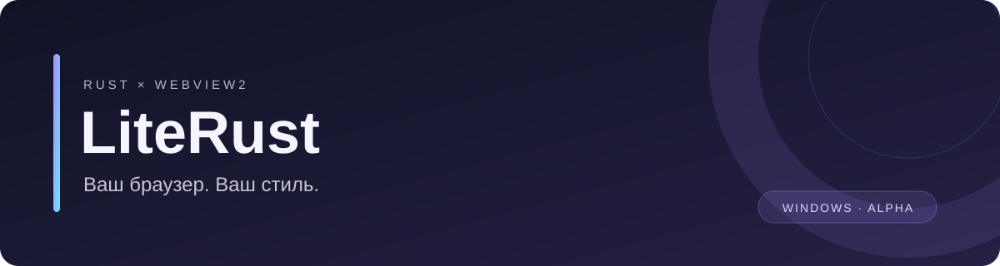

<div align="center">



**Ваш браузер. Ваш стиль.**

Экспериментальный браузер для Windows с настраиваемым интерфейсом и встроенным VPN-хабом.

[](https://github.com/m1rak03/LiteRust/releases/tag/v0.13.0-alpha.1)


[](https://github.com/m1rak03/LiteRust/actions/workflows/literust-release.yml)

### [↓ Скачать для Windows](https://github.com/m1rak03/LiteRust/releases/download/v0.13.0-alpha.1/LiteRust-0.13.0-alpha.1-Setup-x64.exe)

**Полный установщик · x64 · ≈ 240 МиБ · WebView2 включён**

[Все релизы](https://github.com/m1rak03/LiteRust/releases) · [Исходный код](release-source/literust-browser-0.13.0-alpha.1-source.zip) · [Сообщить об ошибке](https://github.com/m1rak03/LiteRust/issues/new?template=bug_report.yml)

</div>

---

## Знакомьтесь: LiteRust

LiteRust объединяет оболочку на **Rust** и движок **Microsoft WebView2**. Интерфейс можно настроить под себя: выбрать оформление, поменять положение боковой панели и собрать удобную стартовую страницу.

| Возможность | Что доступно |
| :--- | :--- |
| 🎨 Оформление | 5 дизайнов, 55 тем, фон с компьютера или по HTTPS-ссылке, затемнение фона |
| ✨ Персонализация | Выключатель анимаций, компактные вкладки, часы и приветствие; свои иконки кнопок, сайтов и LiteRust в Windows |
| 🧭 Боковая панель | Расположение слева, справа, сверху или снизу; быстрый доступ к настройкам и инструментам |
| 🔎 Новая вкладка | Выбор Google, Яндекса, DuckDuckGo, Bing и Brave; ярлыки из закладок и ссылки на сервисы Google |
| 👤 Аккаунт Google | Открытие официальной страницы входа в постоянном профиле браузера |
| 🌐 VPN-хаб | Импорт поддерживаемых ключей и подписок, выбор сервера и проверка соединения через Xray |
| 💤 Управление вкладками | Выгрузка фоновых страниц и ограничение числа одновременно загруженных вкладок |
| 📚 Повседневные инструменты | Закладки, история, загрузки и приватные окна |

## Установка

1. Скачайте **[LiteRust-0.13.0-alpha.1-Setup-x64.exe](https://github.com/m1rak03/LiteRust/releases/download/v0.13.0-alpha.1/LiteRust-0.13.0-alpha.1-Setup-x64.exe)**.
2. Закройте ранее запущенный LiteRust и откройте скачанный файл.
3. Если WebView2 отсутствует, установщик предложит установить включённый в комплект Runtime.

Отдельно устанавливать Microsoft Edge не требуется. Данные сайтов и настройки сохраняются в профиле пользователя. Файл пока не подписан цифровой подписью.

> Репозиторий приватный: для скачивания нужен вход в GitHub под аккаунтом с доступом. Если видите **404**, проверьте аккаунт и доступ к репозиторию.

## Что изменилось в 0.13.0-alpha.1

- Самостоятельный дизайн новой вкладки: часы, приветствие, поиск и карточки закладок.
- Плавное открытие и переключение вкладок; анимации можно отключить. Системная настройка уменьшения движения также учитывается.
- Свой фон из файла или по HTTPS-ссылке, настройка затемнения, компактные вкладки и показ часов/приветствия.
- Единые SVG-значки и загрузка своих иконок для кнопок, сайтов и LiteRust в Windows. Настройки находятся в разделе «Свои иконки».
- Установщик находит существующую копию и штатно закрывает её перед обновлением, сохраняя профиль. **Это обновление при запуске нового установщика, а не фоновое скачивание версий.**
- VPN можно направить только в браузер либо включить дополнительный системный TUN через sing-box. Системный режим требует подтверждения администратора и действует, пока LiteRust открыт. При его остановке Windows возвращается к обычной сети; постоянного системного kill switch нет. UDP зависит от выбранного сервера и протокола.

Проверки выпуска: 45 Rust-тестов, Windows-target Clippy, Chromium UI, запуск Windows-приложения, TUN → тестовый SOCKS-сервер на резервном диапазоне адресов, очистка маршрута, обновление работающей версии 0.12 с сохранением настроек и удаление. Тест не подтверждает совместимость со всеми провайдерами, UDP-сервисами и конфигурациями Windows.

[Релиз и контрольная сумма SHA-256 →](https://github.com/m1rak03/LiteRust/releases/tag/v0.13.0-alpha.1)

## Важно знать

LiteRust находится на стадии **alpha**: возможны ошибки и изменения поведения.

- **Google:** вход выполняется на официальных страницах. Синхронизация Chrome и автозаполнение из Google Password Manager не реализованы. Google может ограничивать вход во встроенном браузере; бессрочная сессия не гарантируется.
- **VPN:** поддерживаются VLESS, VMess AEAD, Trojan, Shadowsocks, SOCKS5, HTTP(S), совместимые HTTPS-подписки и обычные обёртки `happ://add/`. Tor с мостами, Hysteria2, TUIC, WireGuard, зашифрованные Happ-ссылки и новые варианты шифрования VLESS пока не поддерживаются. В режиме «Только браузер» VPN относится к вкладкам LiteRust; режим «Весь компьютер» использует отдельный TUN-компонент. Изменение VPN требует перезапуска; уже открытые отдельные приватные окна тоже нужно перезапустить.
- **Память:** есть инструменты выгрузки вкладок, но преимущество в потреблении ОЗУ перед другими браузерами пока не подтверждено сравнительными измерениями.

## Если что-то не работает

Журнал запуска находится здесь:

```text
%LOCALAPPDATA%\LiteRustBrowser\diagnostics\startup.log
```

Приложите к [сообщению об ошибке](https://github.com/m1rak03/LiteRust/issues/new?template=bug_report.yml) версию Windows, версию LiteRust, шаги воспроизведения и журнал. Не публикуйте пароли, VPN-ключи, cookies или содержимое профиля.

При проблеме запуска с включённым VPN параметр `--vpn-off` отключает его для восстановления доступа к настройкам.

## Разработка

Исходники версий хранятся в [`release-source/`](release-source). Распакуйте актуальный ZIP: внутри находится проект `literust-browser` с кодом, ресурсами и документацией.

Для Windows-сборки нужны **Rust 1.89+**, инструменты сборки MSVC и Windows SDK. Для запуска нужен WebView2 Runtime.

```powershell
cd literust-browser
cargo test --locked --no-default-features --lib
cargo build --locked --release
```

| Каталог в архиве | Назначение |
| :--- | :--- |
| `src/` | Логика браузера, хранение данных, навигация и VPN |
| `ui/` | HTML/CSS/JavaScript интерфейса |
| `packaging/` | Сборка полного установщика с WebView2 |
| `vendor/xray/` | VPN-движок и сведения о стороннем компоненте |
| `docs/` | Дополнительная документация |

Автоматическая сборка и проверка запуска описаны в [GitHub Actions](.github/workflows/literust-release.yml). Компоненты WebView2, Xray и sing-box распространяются на условиях их правообладателей; сведения о них входят в исходный архив.

---

<div align="center">

**LiteRust** · Rust × WebView2 · Сделайте браузер своим.

</div>
