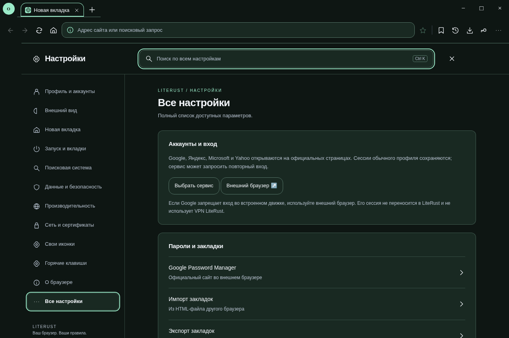

# Настройки LiteRust 0.16

Откройте меню → «Настройки и положение панели». Выберите раздел слева. Поиск сверху ищет по всем разделам; Ctrl+K переводит фокус в строку поиска. На узком экране категории прокручиваются горизонтально.

Изменения оформления применяются сразу. Параметры запуска требуют кнопки сохранения: переключение раздела сохраняет черновик, а напоминание позволяет вернуться к форме.

## Оформление

- Размер текста: 12, 13, 14 или 16 px.
- Скругление вкладок, адресной строки и карточек: 0–24 px.
- Свой акцентный цвет; отключение возвращает акцент темы. Текст на цветной кнопке поиска и знаке LiteRust автоматически становится светлым или тёмным для читаемости.
- Главная: порядок, ширина и видимость виджетов в отдельном редакторе на новой вкладке.
- До 24 быстрых сайтов, независимо от закладок. В редакторе можно добавить ссылку вручную или выбрать закладку.
- Часы в формате 12/24 часа; часы и приветствие можно скрыть.
- Фон: заполнение экрана или показ целиком, размытие 0–20 px, затемнение.

Изменения оформления применяются при выборе. Кнопка сброса относится только к оформлению, не удаляет закладки и профиль. Сохранены предыдущие темы, дизайны, свои иконки и переключатель анимаций.

## Поведение браузера

Нажмите «Сохранить настройки браузера» после изменений:

- При запуске: восстановить вкладки, открыть новую вкладку или домашнюю страницу.
- Домашняя страница: HTTP(S)-адрес без встроенных логина/пароля. Пустое поле — главный экран LiteRust.
- Новая вкладка и Ctrl+T всегда открывают главный экран LiteRust, в том числе поверх VPN или настроек. Домашнюю страницу открывает кнопка «Домой».
- Открывать ссылки, запросившие новую вкладку, без переключения на неё. Фоновые страницы могут загружаться только при выборе вкладки для экономии памяти.
- Масштаб страниц: 50–200%; панель управления не масштабируется.
- Запись истории: выключение прекращает добавление посещений, но не удаляет старую историю, восстановление вкладок, cookies или кэш. Для отдельной сессии используйте приватное окно.

Режим запуска применяется при следующем обычном запуске. Перезапуск при изменении VPN сохраняет текущую сессию. Настройки обычного профиля хранятся в зашифрованном файле DPAPI; настройки приватного окна не сохраняются.

## Вид настроек в локальной alpha.2

## Дополнения 0.15

Каталог содержит 330 тем и 30 стилей вкладок. Поиск фильтрует названия тем. Свой радиус вкладок включается отдельным флажком; иначе действует форма выбранного стиля.

В карточке «Цвет и градиент фона» доступны однотонный, линейный и радиальный фон. Режим «Тема или обои» возвращает сохранённое изображение.

Кнопка «Аккаунты» на новой вкладке и панели открывает выбор официального сервиса. Включите «Показывать выбор при каждом запуске» или сохраните выключенным для показа только при первом запуске. Это меню не определяет текущую авторизацию; список аккаунтов показывает сам сервис.

Панель «Инструменты» содержит поиск открытых вкладок, дублирование, заметки до 20 000 символов, простой калькулятор и печать текущей страницы. Заметки сохраняются кнопкой, в приватном окне остаются временными.

## Окно, новая вкладка и панель

Отдельный режим F11 удалён. Окно открывается развёрнутым; кнопка сверху справа переключает развёрнутый и обычный размер. Кнопка «+», Ctrl+T и кнопка новой вкладки в панели всегда открывают стартовый экран и закрывают открытые настройки/VPN. «Домой» использует сохранённый домашний адрес.

Настройки сгруппированы по категориям: оформление, браузер/аккаунты, данные/память, сеть. Поиск сверху помогает находить параметры. Панель инструментов не скрывается при поиске настроек.

Боковая панель также открывает приватное окно, дублирует вкладку и вызывает печать. Эти команды используют существующие WebView; новые страницы создаются только при явном открытии вкладки или окна.

## Горячие клавиши

Откройте одноимённый раздел. «Изменить» записывает новое сочетание, «Убрать» отключает команду, «Сброс» возвращает стандартные клавиши. Esc отменяет запись; конфликтующее сочетание не сохраняется. Изменения применяются сразу и сохраняются в обычном профиле. Ctrl+C/V/X/A/Z/Y и системные сочетания Windows не переназначаются. Дополнительным действиям (VPN, инструменты, аккаунты, дублирование вкладки) можно назначить свои клавиши.

Доступны 34 настраиваемые команды. Старое назначение fullscreen удаляется при миграции; остальные сочетания сохраняются.

## Локальные профили и фото

Круглая кнопка слева от вкладок открывает управление профилями. Создайте профиль с именем, выберите его или переименуйте текущий. PNG, JPEG и WebP преобразуются в небольшой PNG-аватар. Имя и фото локальные: они не подтверждают вход в Google, Яндекс или другой сервис.

Каждый профиль имеет собственные настройки, закладки, историю, VPN-конфигурацию и данные WebView2. Другой профиль открывается отдельным процессом; уже открытый профиль повторно не открывается. Дополнительный закрытый профиль можно убрать после подтверждения. Данные сохраняются в ProfileTrash; текущий и основной профиль удалить нельзя.

## Редактор главной

Нажмите кнопку редактирования на главной. Перетаскивайте виджеты за ручку или меняйте порядок кнопками; задавайте ширину ползунком либо краем карточки. В списке можно скрыть и вернуть любой виджет, изменить заголовок и подпись. «Отмена» возвращает предыдущий шаг, «Сброс» восстанавливает исходную сетку. Нажмите «Сохранить», чтобы записать изменения. В приватном окне они временные.

Плитка «+» добавляет быстрый сайт. Меню плитки позволяет менять название/адрес и удалять её. На узком окне сетка становится одноколоночной, порядок сохраняется.

## Раскрывающаяся панель

В оформлении выберите раскрытие по нажатию, по наведению или закрепление. Настройте ширину 220–320 пикселей, порядок и видимость действий. Временное раскрытие накрывает страницу, закреплённая панель занимает место рядом с ней. Верхнее и нижнее положения остаются компактными. Отключение анимаций и системное уменьшение движения убирают плавный переход.
