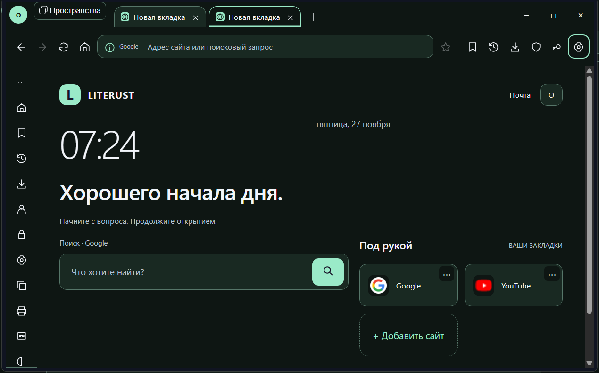
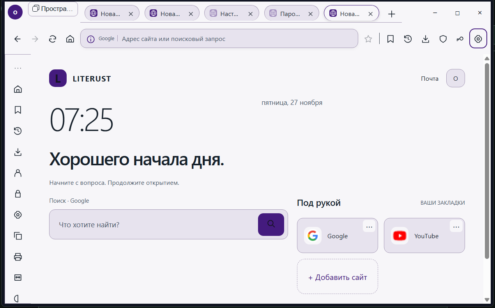
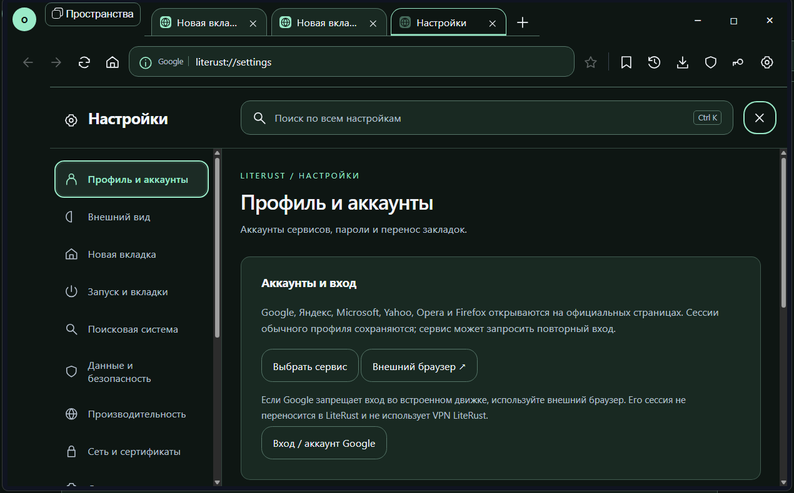
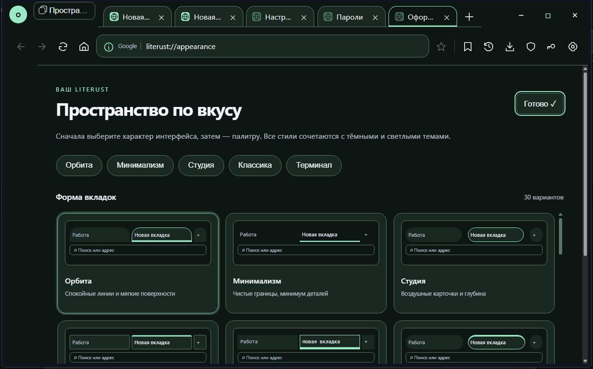
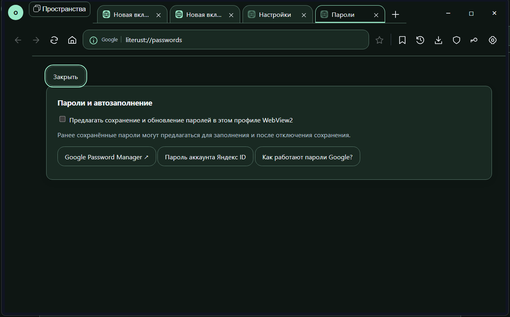
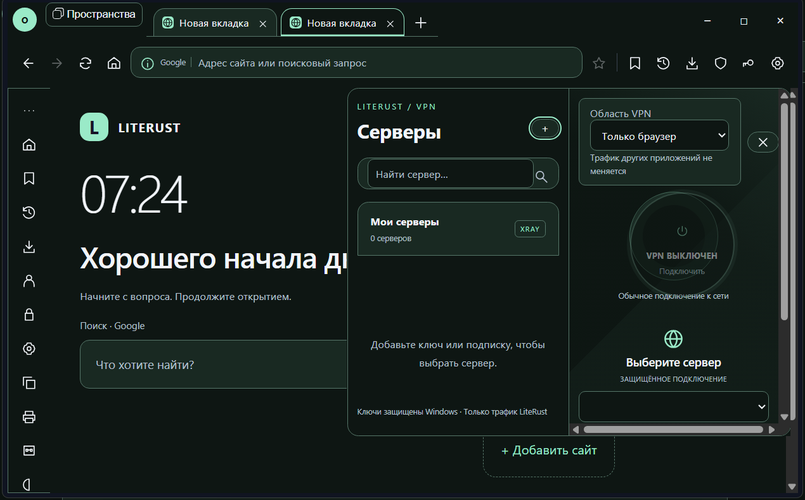
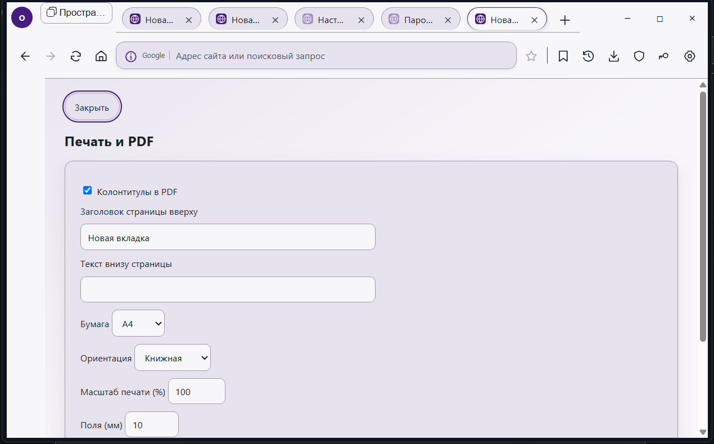
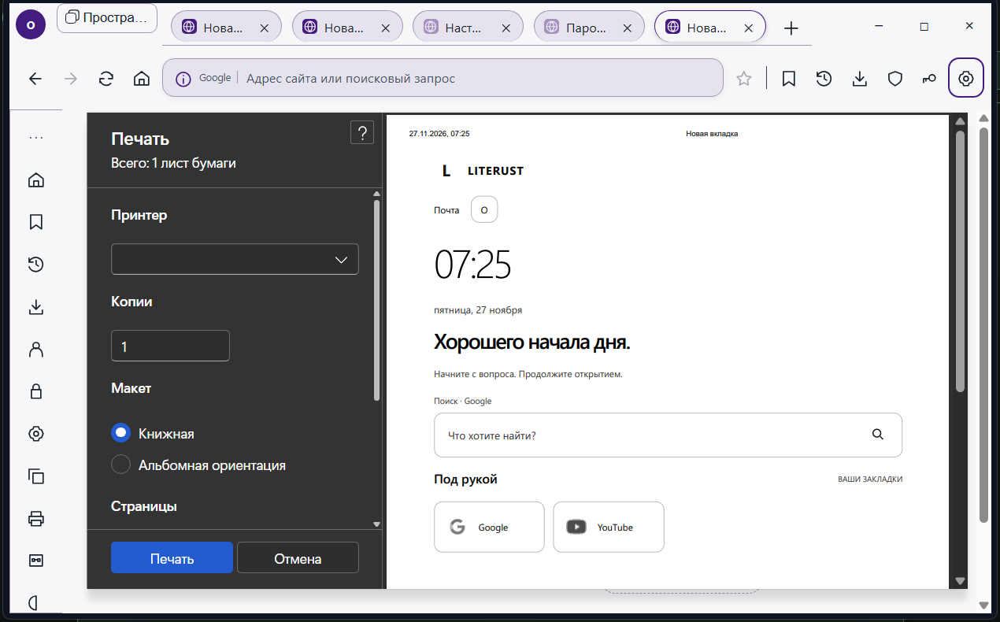

# LiteRust 0.18.0-alpha.7 · Windows

Снимки сделаны в работающем браузере с временным локальным профилем. Настройки принтера зависят от драйвера Windows.

These screenshots show the running browser using a temporary local profile. Printer options depend on the Windows driver.

## Главная страница / Home

## Светлая тема / Light theme

## Вкладка настроек / Settings tab

## Оформление / Appearance

## Параметры паролей / Password preferences

## Панель VPN / VPN panel

## Параметры экспорта PDF / PDF export settings

## Предпросмотр печати / Print preview

